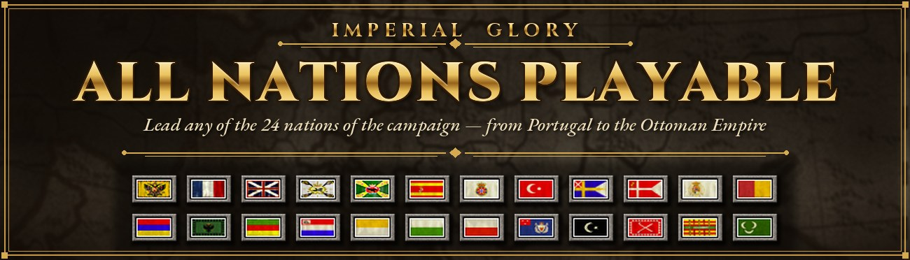

<p align="center">
  
</p>

<p align="center">
  <b>Play the <i>Imperial Glory</i> campaign as any of the 24 nations – from Portugal to the Ottoman Empire.</b><br>
  No bonuses, no new units, no balance changes. Just every nation playable.
</p>

<p align="center">
  <a href="https://www.nexusmods.com/imperialglory/mods/4"></a>
  
  
  <a href="LICENSE"></a>
</p>

---

## Contents

- [Features](#features)
- [Installation](#installation)
- [Is it safe?](#is-it-safe)
- [Building from source](#building-from-source)
- [How it works](#how-it-works)
- [Version history](#version-history)
- [License](#license)

## Features

- **All 24 nations playable** in the campaign. In addition to the five great powers, these nations can now be played:
  Batavian Republic · Denmark · Egypt · Hanover · Helvetic Republic · Kingdom of the Two Sicilies · Lombardy · Moldavia · Morocco · Ottoman Empire · Papal States · Piedmont · Poland · Portugal · Saxony · Spain · Sweden · Tripolitania · Tunisia
- Conquest, permanent occupation and annexation through sympathy work for minor nations too.
- Every nation can be clicked on the selection map, including North Africa. Each nation shows its own flag.
- Your original `ImperialGlory.exe` stays untouched. The mod runs as a separate `ImperialGlory_AllNations.exe`.
- Uninstall with one click.

## Installation

1. Download the mod from [Nexus Mods](https://www.nexusmods.com/imperialglory/mods/4).
2. Copy the `AllNations-Mod` folder into the game folder, next to `ImperialGlory.exe`.
   *Steam: right-click Imperial Glory → Manage → Browse local files.*
3. Run `Install.bat` and answer the two questions (Windows 98/ME compatibility mode is recommended).
4. Start `ImperialGlory_AllNations.exe` or use the desktop shortcut. Then pick any nation on the map.

To uninstall, run `Uninstall.bat` and delete the folder.

> **Requires the Steam version.** The installer checks your exe and refuses anything else. GOG and CD versions are not supported yet.

## Is it safe?

The download contains **no .exe or .dll files**. All it contains:

| File | What it is |
|---|---|
| `Install.bat` / `Uninstall.bat` | A single line that runs `patcher.ps1` with PowerShell. |
| `patcher.ps1` | Plain-text installer you can read. It checks the MD5 of your `ImperialGlory.exe` and writes a patched **copy**. Then it checks the result's MD5 and copies `ALLNATIONS.PAK`. Optionally it sets the compatibility flag and creates a shortcut. |
| `ALLNATIONS.PAK` | A normal ZIP archive with six modified text data files of the game. |
| `README.txt` | User documentation. |

The installer does not download anything and does not use the network. Uninstalling removes exactly what the installer created.

The byte patches in `patcher.ps1` are written as hex values. This repository contains their **readable source code**. A build script rebuilds the released files from that source, byte for byte, so you can check that the download contains only what the source code says.

## Building from source

You need Python 3.8+ and an unmodified Steam `ImperialGlory.exe` (MD5 `d2c8a4580bbcfb34a37dae3214b198ea`). The game itself is not part of this repository.

```bash
pip install -r requirements.txt
python tools/build.py "C:\Program Files (x86)\Steam\steamapps\common\Imperial Glory\ImperialGlory.exe"
```

The script writes everything to `out/` and compares it with the released files in `mod/`. Expected output:

```
37 patches applied
ImperialGlory_AllNations.exe  MD5 c0f421a34b57ebb35cf60b93970da764
patcher.ps1                   MD5 b420bf96623e47355fa534b017b4347e  identical to release
ALLNATIONS.PAK                MD5 8d5570b81e09774fd2bb0325ce0f3e01  identical to release
exe MD5 matches the MD5 the release installer expects: True
```

| Output | |
|---|---|
| `ImperialGlory_AllNations.exe` | patched exe, for testing (the release does not ship an exe) |
| `patches.json` | every byte change with offset, old bytes, new bytes and a description |
| `patcher.ps1` | regenerated installer |
| `ALLNATIONS.PAK` | rebuilt from `pak/` |
| `AllNations-Mod.zip` | the complete release folder |

### Repository layout

```
src/patches.py              all 37 exe changes as commented x86 assembly
tools/build.py              build + comparison with the release
tools/patcher_template.ps1  the installer without the generated patch table
pak/Game/...                the six data files that go into ALLNATIONS.PAK
mod/                        the released files, unchanged, for comparison
docs/                       images for this page
```

## How it works

The Steam `ImperialGlory.exe` is a 32-bit program without ASLR, so all addresses are fixed. New code goes into unused `0xCC` padding at the end of the `.text` section (`0x880F00`–`0x882000`). Before changing anything, every patch checks that the original bytes are exactly what the build expects, or that the padding is still empty.

| # | Area | Change |
|---|---|---|
| 1 | Selection menu | The hard-coded check that allows only the five great powers accepts every nation. |
| 2 | Quest lookups | Two guards for map lookups that read invalid memory when a minor nation was played. |
| 3 | Turn order | Turn-order sections are loaded for all 24 nations instead of five; missing sections are skipped. Previously this crashed at campaign start. |
| 4 | Nation list | A wrapper lets the list builder include every nation. |
| 5 | Human player | The human player is marked as a great power internally, so conquest, permanent occupation and annexation work. |
| 6 | Progress panel | NULL checks for great-power entries that do not exist when a minor nation is played. |
| 7 | Selection list | Two-pass list: great powers first. Minor-nation rows are moved off-screen, so the list no longer covers the OK button. |
| 8 | Data loading | `ALLNATIONS.PAK` is mounted after the game's own archives. |

The full assembly with comments is in [`src/patches.py`](src/patches.py).

### Data files in `ALLNATIONS.PAK`

| File | Change |
|---|---|
| `Game/UI/MainMenu/SelectEmpire/UIDefs_MapaPaisesSelectEmpire.sb` | every nation clickable on the selection map |
| `Game/GameModes/Gestion/DefOrdenTurnos.sb` | turn order when a human plays a minor nation |
| `Game/UI/ModeloGestion/Iconos/UIDefs_PoolIconosNotificaciones.sb` | start icons for minor nations |
| `Game/UI/MainMenu/UIDefs_SelectEmpire.sb`, `.../SelectEmpire/UIDefs_ZSToolTips.sb` | smaller info box below the map, so North Africa is no longer hidden |
| `Game/UI/MainMenu/SelectEmpire/UIDefs_Banderas.sb` | each nation's own flag in the info box |

## Version history

| Version | Changes |
|---|---|
| **1.1** | North African nations can be clicked on the map. The list on the right no longer covers the OK button. Minor nations show their own flag instead of the Austrian coat of arms. |
| **1.0** | First release. |

**Known limitations:** minor nations have no resource bars in the selection menu, use a placeholder start icon and have no victory sequence of their own. Savegames with a minor nation load only in `ImperialGlory_AllNations.exe`.

## License

The source code in `src/` and `tools/` and the installer in `mod/` are released under the [MIT license](LICENSE).

*Imperial Glory* and its data files belong to their respective rights holders. The files in `pak/` and the images in `docs/` contain modified game assets and are included only to build and present the mod. This project is not affiliated with or endorsed by the publisher.
